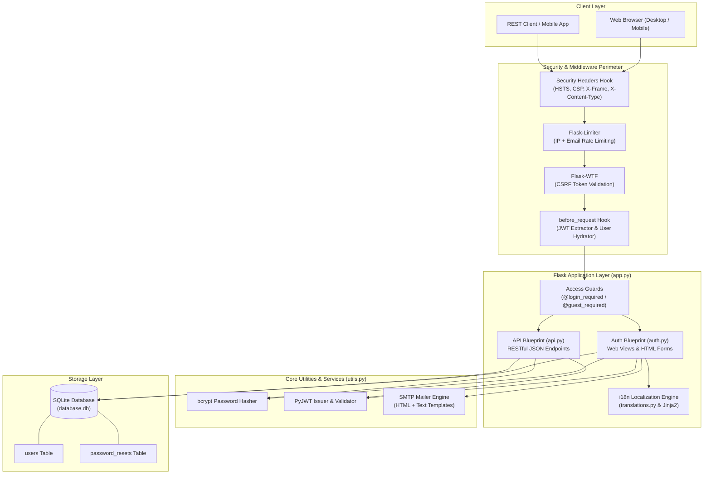
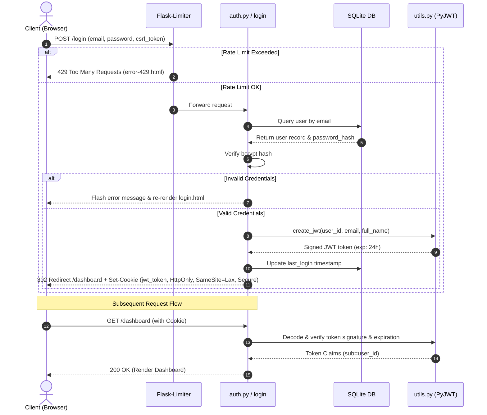
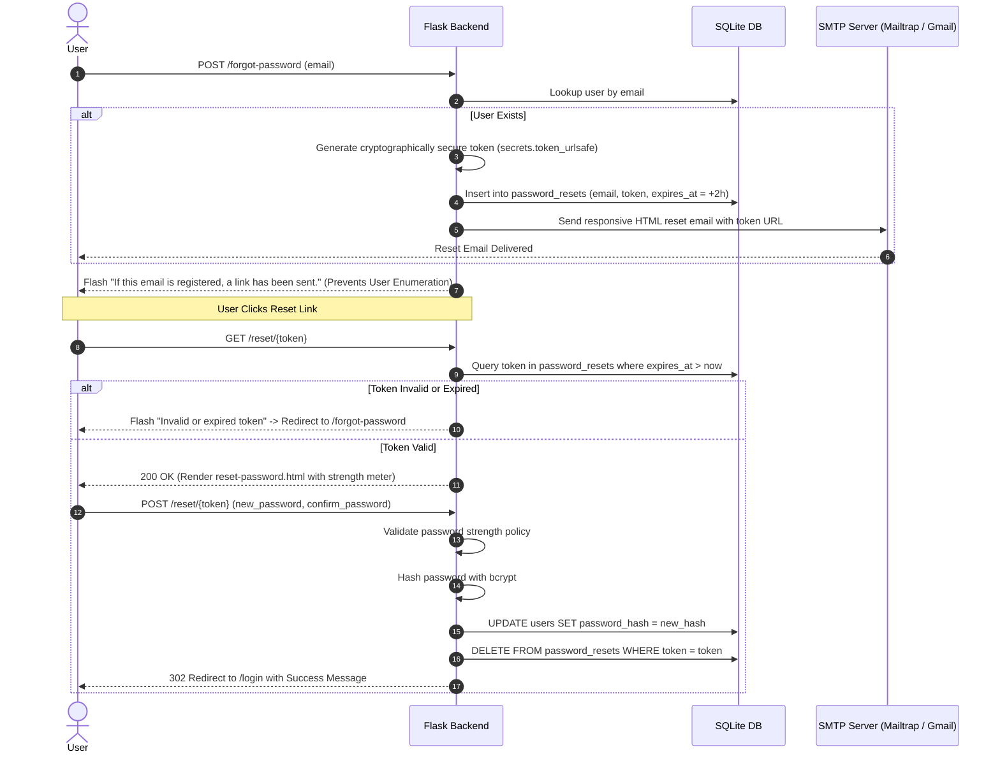
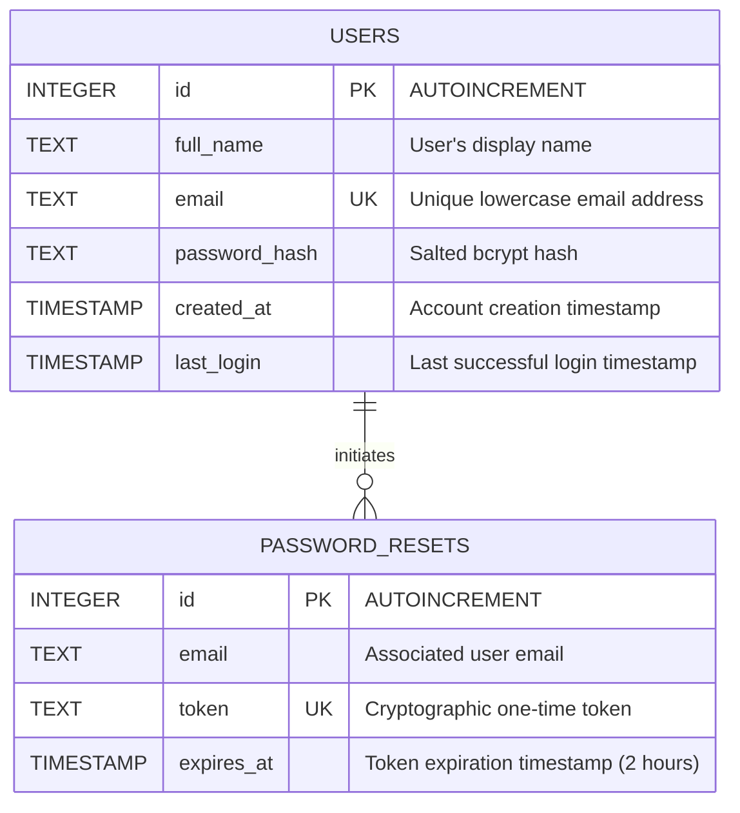
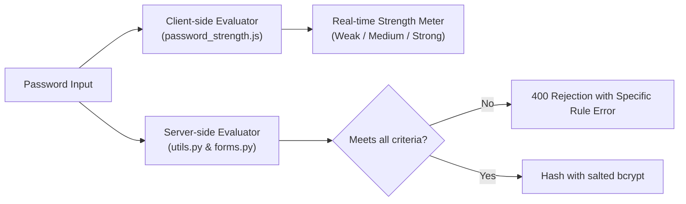

# 🛡️ Nimbus Auth

> **A modern, production-ready, lightweight authentication boilerplate and RESTful API powered by Python Flask, SQLite, and Tailwind CSS.**

[](https://www.python.org/)
[](https://palletsprojects.com/p/flask/)
[](https://tailwindcss.com/)
[](https://www.sqlite.org/)
[](https://owasp.org/)
[-orange.svg)](#-internationalization--rtl-support)
[](LICENSE)

---

## 📌 Table of Contents

- [Overview](#-overview)
- [Key Features](#-key-features)
- [System Architecture](#-system-architecture)
- [Interactive Flows & Sequence Diagrams](#-interactive-flows--sequence-diagrams)
  - [Authentication & JWT Lifecycle](#1-authentication--session-lifecycle)
  - [Password Recovery via SMTP](#2-secure-password-recovery-flow)
- [Database Schema](#-database-schema)
- [RESTful JSON API Reference](#-restful-json-api-reference)
- [Web Routes](#-web-routes)
- [Internationalization & RTL Support](#-internationalization--rtl-support)
- [Live Password Strength Engine](#-live-password-strength-engine)
- [Project Directory Layout](#-project-directory-layout)
- [Getting Started](#-getting-started)
  - [Prerequisites](#prerequisites)
  - [Installation & Setup](#installation--setup)
  - [Environment Configuration](#environment-configuration)
  - [Compiling Tailwind CSS](#compiling-tailwind-css)
  - [Running the Application](#running-the-application)
- [Security Model & Hardening](#-security-model--hardening)
- [License](#-license)

---

## 🌟 Overview

**Nimbus Auth** solves the common dilemma between heavy, complex enterprise identity providers and insecure toy authentication scripts. It delivers an all-in-one, secure-by-default full-stack starter template:

- **Zero-Heavyweight Infrastructure**: Persists data cleanly into **SQLite**, requiring zero external database daemon configuration to spin up locally or on small VPS instances.
- **Dual Authentication Paradigms**: Handles browser sessions with hardened `HttpOnly`, `SameSite=Lax` cookies while seamlessly serving headless Single-Page Applications (SPAs) and mobile clients via `Authorization: Bearer <token>` JSON endpoints.
- **SaaS-Ready UI**: Features a clean landing page, responsive authentication forms, user dashboard, language switcher, and light/dark theme toggles.

---

## ✨ Key Features

| Domain | Feature | Description |
| :--- | :--- | :--- |
| **Authentication** | Dual Sessions | JWTs issued in hardened cookies for web browsing and bearer tokens for REST APIs |
| **Password Security** | bcrypt Hashing | Passwords hashed with salted bcrypt before saving; never stored in plaintext |
| **Password Policy** | Live Strength Meter | Client-side real-time UI meter + strict server-side regex validator (8+ chars, upper, lower, number, symbol) |
| **Brute-Force Guard** | Rate Limiting | `Flask-Limiter` throttling configured per IP + email combination to stop brute-force attacks |
| **CSRF Defense** | Form Tokenization | `Flask-WTF` CSRF protection on all HTML form mutations |
| **Route Protection** | Custom Decorators | `@login_required` guards private pages; `@guest_required` redirects logged-in users away from auth forms |
| **Email Integration** | Transactional Mailer | Responsive HTML emails for password resets (with expiring tokens) and welcome greetings via SMTP |
| **Global Ready** | Multilingual (i18n) | Instant locale switching for English, French, and Arabic with native Right-to-Left (RTL) layout support |
| **Design System** | Tailwind CSS & Themes | Dark mode and light mode with instant local storage persistence and mobile slide-over drawer |

---

## 🏗️ System Architecture

The following diagram illustrates how incoming traffic traverses security layers, business logic, and storage services:



---

## 🔄 Interactive Flows & Sequence Diagrams

### 1. Authentication & Session Lifecycle



### 2. Secure Password Recovery Flow



---

## 🗄️ Database Schema

The SQLite database (`database.db`) uses a clean, normalized relational design:



---

## 📡 RESTful JSON API Reference

In addition to traditional web views, Nimbus Auth includes a full JSON REST API under `/api`.

### Endpoints Matrix

| Method | Endpoint | Auth Required | Description | Status Codes |
| :--- | :--- | :---: | :--- | :--- |
| `POST` | `/api/auth/register` | No | Register a new user | `201`, `400` |
| `POST` | `/api/auth/login` | No | Authenticate user & receive JWT token | `200`, `401`, `429` |
| `GET` | `/api/me` | **Bearer JWT** | Fetch authenticated user profile | `200`, `401` |
| `POST` | `/api/auth/forgot-password`| No | Request password reset token | `200`, `400` |
| `POST` | `/api/auth/reset-password` | No | Reset password using valid token | `200`, `400` |
| `POST` | `/api/auth/logout` | No | Clear authentication cookies | `200` |

### Sample API Requests & Responses

#### 1. User Login
```bash
curl -X POST http://127.0.0.1:5000/api/auth/login \
  -H "Content-Type: application/json" \
  -d '{
    "email": "alex@example.com",
    "password": "SuperSecretPassword123!"
  }'
```

**Response (200 OK):**
```json
{
  "message": "Login successful",
  "token": "eyJhbGciOiJIUzI1NiIsInR5cCI6IkpXVCJ9...",
  "user": {
    "id": 1,
    "email": "alex@example.com",
    "full_name": "Alex Mercer"
  }
}
```

#### 2. Get Current Profile
```bash
curl -X GET http://127.0.0.1:5000/api/me \
  -H "Authorization: Bearer <your_jwt_token>"
```

**Response (200 OK):**
```json
{
  "user": {
    "id": 1,
    "email": "alex@example.com",
    "full_name": "Alex Mercer",
    "created_at": "2026-04-19 14:30:00",
    "last_login": "2026-04-20 09:15:22"
  }
}
```

---

## 🌐 Web Routes

| Route | View Function | Description |
| :--- | :--- | :--- |
| `/` | `landing()` | Modern marketing landing page showcasing product features and pricing |
| `/register` | `auth.register()` | User signup form guarded by live password meter and `@guest_required` |
| `/login` | `auth.login()` | Login form with "Remember Me", rate limiting, and `@guest_required` |
| `/forgot-password` | `auth.forgot_password()` | Password reset request trigger with user enumeration prevention |
| `/reset/<token>` | `auth.reset_password()` | Token-validated password update view |
| `/dashboard` | `auth.dashboard()` | Authenticated private user area with interactive API testing inspector |
| `/logout` | `auth.logout()` | Clears session cookie and redirects to `/login` |

---

## 🌍 Internationalization & RTL Support

Nimbus Auth features a native i18n localization engine (`translations.py`) requiring zero heavy gettext compilation.

- **Supported Languages**:
  - 🇺🇸 **English** (`en`) — Default (LTR)
  - 🇫🇷 **French** (`fr`) — LTR
  - 🇸🇦 **Arabic** (`ar`) — **Native RTL (Right-to-Left)** layout with proper typography and directional mirroring.
- **Language Switching**: Users can toggle languages anytime via the desktop dropdown or mobile drawer; the selection is preserved across sessions via the `lang` cookie.
- **Template Helper**: Any template accesses localized strings through `{{ t('key_name') }}` with contextual interpolation.

---

## 🔐 Live Password Strength Engine

Passwords must meet robust complexity criteria on both sides of the network:



### Password Rules Checklist
- [x] Minimum 8 characters in length
- [x] At least one uppercase Latin letter (`A-Z`)
- [x] At least one lowercase Latin letter (`a-z`)
- [x] At least one numeric digit (`0-9`)
- [x] At least one special symbol (`!@#$%^&*()_+-=[]{}|;:,.<>?`)

---

## 📂 Project Directory Layout

```text
nimbus-auth/
├── app.py                     # App factory, request hooks, error handlers & config
├── auth.py                    # Web authentication routes (Blueprint: auth_bp)
├── api.py                     # RESTful JSON endpoints (Blueprint: api_bp)
├── models.py                  # SQLite database access layer & schema migrations
├── forms.py                   # Flask-WTF secure forms with field validators
├── decorators.py              # Custom route decorators (@guest_required)
├── extensions.py              # Flask extensions setup (CSRFProtect, Limiter)
├── utils.py                   # Security utilities (bcrypt, PyJWT, SMTP mailer)
├── translations.py            # Multilingual string dictionary (EN, FR, AR)
├── database.db                # SQLite database file
├── requirements.txt           # Python backend dependencies
├── package.json               # Node.js dependencies for Tailwind CLI
├── tailwind.config.js         # Tailwind styling & dark mode configuration
├── templates/                 # Jinja2 HTML templates
│   ├── base.html              # Shell layout with responsive navbar & drawer
│   ├── landing.html           # Marketing homepage
│   ├── login.html             # Login view
│   ├── register.html          # Registration view
│   ├── forgot-password.html   # Password recovery request view
│   ├── reset-password.html    # Password update view
│   ├── dashboard.html         # User dashboard & API token inspector
│   ├── error-404.html         # Custom 404 page
│   └── error-429.html         # Custom rate limit 429 page
└── static/
    ├── css/
    │   └── app.css            # Compiled Tailwind CSS output
    ├── src/
    │   └── tailwind.css       # Tailwind source styles
    └── js/
        ├── app.js             # Theme toggle & mobile drawer logic
        └── password_strength.js # Live password strength calculator
```

---

## 🚀 Getting Started

### Prerequisites

- **Python**: 3.12 or newer
- **Node.js**: 18+ (for building Tailwind CSS styles)
- **Git**

### Installation & Setup

#### 1. Clone the repository
```bash
git clone https://github.com/SfAtRhl/cip_project.git nimbus-auth
cd nimbus-auth
```

#### 2. Configure Python Virtual Environment
```bash
# On Linux / macOS
python3 -m venv .venv
source .venv/bin/activate

# On Windows (PowerShell)
python -m venv .venv
.venv\Scripts\Activate.ps1
```

#### 3. Install Python Dependencies
```bash
pip install -r requirements.txt
```

#### 4. Install Node Dependencies & Build CSS
```bash
npm install
npm run build:css
```

---

### Environment Configuration

Copy the example environment configuration to create your local `.env`:

```bash
cp .env.example .env
```

Edit `.env` to configure your settings:

```ini
# Flask Secrets
SECRET_KEY=change-this-to-a-secure-random-secret
JWT_SECRET_KEY=change-this-to-another-secure-secret

# JWT Expiration (Seconds)
JWT_EXPIRES_IN=86400

# Rate Limiting (Flask-Limiter)
RATE_LIMIT=10 per minute

# SMTP Mailer Settings (e.g., Mailtrap or Gmail SMTP)
SMTP_HOST=smtp.mailtrap.io
SMTP_PORT=2525
SMTP_USERNAME=your_username
SMTP_PASSWORD=your_password
SMTP_USE_TLS=true
SMTP_FROM=no-reply@nimbusauth.local
```

> [!TIP]
> For local testing without a live SMTP host, password reset tokens and email payloads are logged directly to the application console when `SMTP_HOST` is left empty.

---

### Running the Application

```bash
python app.py
```

The application will start immediately at **`http://127.0.0.1:5000`**.

- **Landing Page**: `http://127.0.0.1:5000/`
- **Register**: `http://127.0.0.1:5000/register`
- **Login**: `http://127.0.0.1:5000/login`
- **Dashboard**: `http://127.0.0.1:5000/dashboard`

---

## 🛡️ Security Model & Hardening

Nimbus Auth is architected in accordance with OWASP security guidelines:

- **Bcrypt Salted Password Hashing**: Utilizes blowfish-based salting resistant to rainbow-table and GPU cracking attacks.
- **Strict Cookie Hardening**: Cookies are flagged with `HttpOnly` (inaccessible to JavaScript `document.cookie`), `SameSite=Lax` (defends against Cross-Site Request Forgery), and `Secure` in production.
- **OWASP Security Headers**: Applied automatically to all outgoing responses:
  - `X-Frame-Options: SAMEORIGIN` (prevents clickjacking)
  - `X-Content-Type-Options: nosniff` (prevents MIME-type sniffing)
  - `X-XSS-Protection: 1; mode=block`
  - `Content-Security-Policy: default-src 'self' ...`
- **Anti-Enumeration Protection**: The password recovery route outputs identical confirmation messages whether or not an email address exists in the database.
- **Expiring Nonce Tokens**: Password reset tokens expire in 2 hours and are instantly deleted from SQLite once redeemed.
- **Combined IP + Email Throttling**: Stops credential stuffing by throttling bursts to `/login`.

---

## 📄 License

This project is licensed under the [MIT License](LICENSE).
